# Pult

Serverni boshqarish uchun ilova: **terminal + fayllar**, bitta oynada, minimal dizayn.
Windows va Android. Bepul va ochiq kodli (MIT).

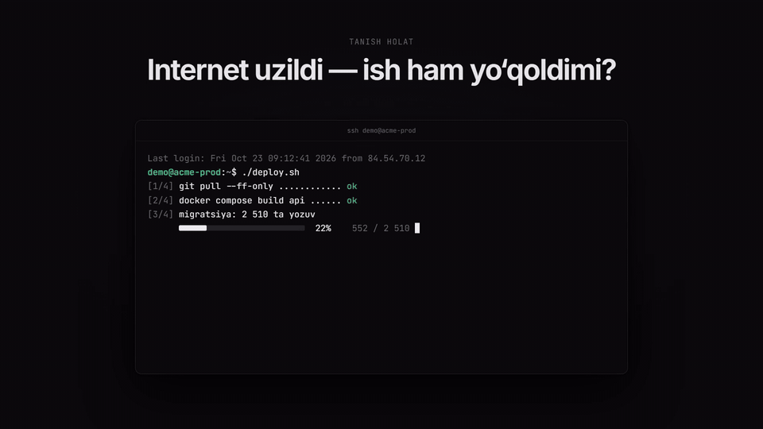

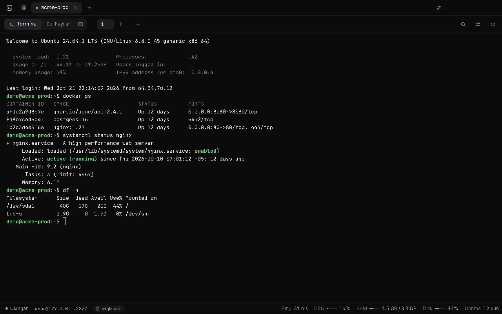
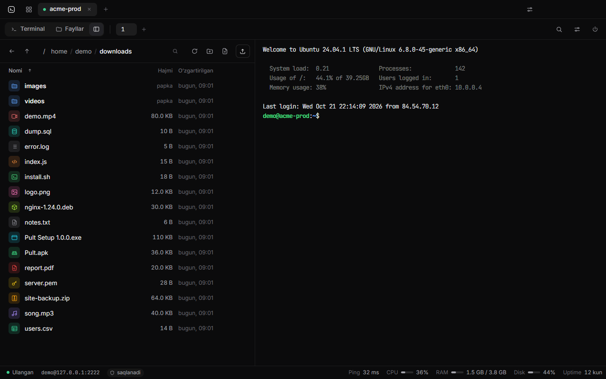

🎬 Promo video: [gorizontal (1920×1080)](docs/promo/pult-promo.mp4) · [vertikal (1080×1920)](docs/promo/pult-promo-vertical.mp4)

## O‘rnatish

Tayyor fayllar **Releases** sahifasida:

- `Pult.Setup.1.1.0.exe` — Windows o‘rnatuvchisi (Start menyu va ish stolida yorliq paydo bo‘ladi).
- `Pult-portable.exe` — o‘rnatmasdan ishlaydi.
- `Pult.apk` — Android 7.0 va undan yangi telefonlar uchun.

Ilova raqamli imzolanmagan, shuning uchun Windows birinchi marta “Windows protected your PC” deb ko‘rsatishi mumkin:
**More info → Run anyway**.

## Aloqa uzilmasligi (1:1)

- **Sessiya saqlanadi.** Har bir terminal serverda alohida `tmux` sessiyasi ichida ishlaydi (sizning tmux sozlamalaringizga tegmaydi).
  Internet uzilsa, kompyuter uxlab qolsa yoki ilovani yopsangiz ham, serverdagi jarayonlar ishlashda davom etadi.
  Qayta ulanganda terminal aynan qolgan joyidan ochiladi.
  Serverga tmux o‘rnatib qo‘ying: `sudo apt install tmux` (yoki `dnf install tmux`).
- **Avtomatik qayta ulanish.** Keepalive o‘lik aloqani ~20 soniyada aniqlaydi, so‘ng 1, 2, 3, 5… soniya oraliqda o‘zi qayta ulanadi.
  Uyqudan uyg‘onganda yoki internet qaytganda darhol tekshiradi.
- **Fayl uzatish davom etadi.** Yuklash/yuklab olish paytida aloqa uzilsa, ish to‘xtab turadi va
  qayta ulanganda boshidan emas, qolgan joyidan davom etadi.

## AI agentlar: Claude Code va agy

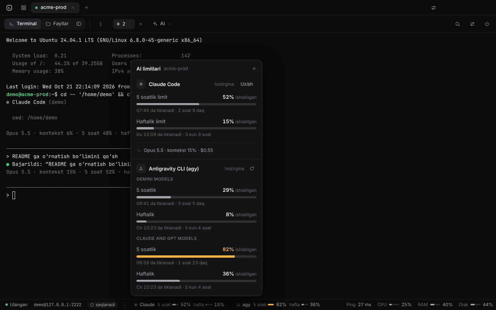

Serverda [Claude Code](https://code.claude.com) (`claude`) yoki Antigravity CLI (`agy`) o‘rnatilgan bo‘lsa, Pult ularni o‘zi topadi.

- **Limitlar doim ko‘rinib turadi.** Holat qatorida obunangizning 5 soatlik va haftalik limiti qancha ishlatilgani,
  bosganda esa batafsil: qachon tiklanishi, qolgan vaqt, joriy terminaldagi model va kontekst.
  - *Claude Code:* birinchi marta holat qatoridagi **Claude → limitni ulash** ni bosing. Pult serverdagi
    `~/.claude/settings.json` ga kichik status line skriptini (`~/.pult/bin/claude-statusline`) ulaydi —
    Claude Code limit ma’lumotini aynan shu yo‘l bilan beradi. O‘zingizning status line’ingiz bo‘lsa, u ham
    ishlashda davom etadi; avvalgi fayl `settings.json.pult-backup` sifatida saqlanadi, **Uzish** hammasini
    avvalgi holatiga qaytaradi. Ma’lumot Claude Code har javob berganda yangilanadi (faqat Pro/Max obunada bor).
  - *agy:* `agy -p /usage` orqali o‘zi olinadi (har 3–10 daqiqada, panelda **yangilash** tugmasi ham bor),
    har bir model guruhi alohida ko‘rsatiladi.
- **Bir bosishda ishga tushirish.** Asboblar qatoridagi **AI** tugmasi (`Ctrl+Shift+A`): Claude Code yoki agy yangi
  terminalda, joriy terminal turgan papkada ochiladi; **oxirgi suhbat** (`-c`) ham bor. Fayllarda papkani
  o‘ng tugma bilan bosing → **Claude Code’ni shu yerda ochish**.
- **Qaysi terminalda agent ishlayotgani** yorliqda belgi bilan ko‘rinadi.
- **Bildirishnoma.** Boshqa oyna yoki serverda bo‘lsangiz va agent ishni tugatsa yoki ruxsat so‘rasa (terminal signali),
  yorliqda nuqta paydo bo‘ladi va Windows bildirishnomasi chiqadi — bosilsa, o‘sha terminal ochiladi.
  Claude Code uchun signal limitlarni ulaganda yoqiladi (`preferredNotifChannel`, agar o‘zingiz boshqasini tanlamagan bo‘lsangiz).
- **Shift+Enter — yangi qator** (xabarni yubormasdan).
- **Skrinshot va fayllar.** Rasmni `Ctrl+V` bilan qo‘ysangiz yoki faylni terminalga sudrab tashlasangiz, u serverdagi
  `~/.pult/uploads` papkasiga yuklanadi va yo‘li yoziladi — Claude Code va agy rasmni shu yo‘l orqali ko‘radi.
  7 kundan eski yuklamalar o‘zi o‘chiriladi.
- Sozlamalar → **AI agentlar**: limitlar, bildirishnomalar, Shift+Enter va ishga tushirish buyrug‘i
  (masalan, `claude --model opus`).

## Imkoniyatlar

- To‘liq terminal (xterm.js): ranglar, vim, htop, mc, sichqoncha, Unicode, qidiruv.
- Serverdagi dasturlar (tmux, vim, Claude CLI) nusxalagan matn to‘g‘ridan-to‘g‘ri Windows buferiga tushadi (OSC 52).
- Bir serverda bir nechta terminal, bir vaqtda bir nechta server.
- Holat qatori: ping, CPU, RAM, disk, uptime va AI agent limitlari.
- Parollar Windows himoyasi (DPAPI) bilan shifrlab saqlanadi. Server kaliti birinchi ulanishda tasdiqlanadi.
- Parol, SSH kalit yoki ssh-agent orqali kirish; `~/.ssh/config` dan import.
- Qorong‘i va yorug‘ mavzu.

### Fayllar

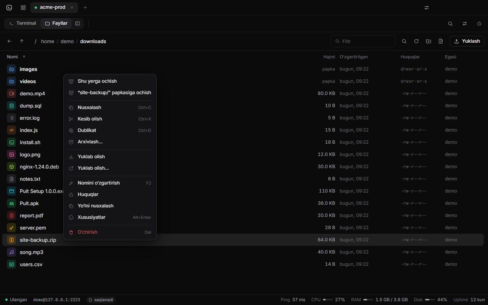

- Ko‘rish, yuklash (sudrab tashlash ham), yuklab olish, nomini o‘zgartirish, o‘chirish, huquqlar (chmod), yangi papka/fayl.
- Papka va fayllar oson ajraladi: har bir fayl turi o‘z belgisi va rangiga ega (APK, EXE, arxiv, rasm, video, kod, SQL, kalit…).
- **Nusxalash / kesib olish / qo‘yish** — server ichida, yuklab olmasdan (`cp -a`, `mv`). Bir xil nom bo‘lsa
  `nom (1)` qilib qo‘yadi, hech narsani ustidan yozmaydi. **Dublikat** — bir bosishda nusxa.
- **Arxivlash:** belgilangan fayl/papkalardan `.zip` yoki `.tar.gz` yasash; `.zip`, `.tar.gz`, `.tgz`, `.tar.xz`, `.tar.bz2`, `.tar`
  arxivlarini “shu yerga” yoki alohida papkaga ochish. Hammasi serverning o‘zida bajariladi.
- **Qidiruv:** joriy papka va ichidagi papkalarda fayl nomi bo‘yicha yoki fayl ichidagi matn bo‘yicha.
  Natijani bossangiz, fayl muharrirda aynan shu qatorda ochiladi.
- **Xususiyatlar:** turi, joylashuvi, hajmi, sanasi, huquqlar, egasi; papka uchun umumiy hajm va fayllar soni.

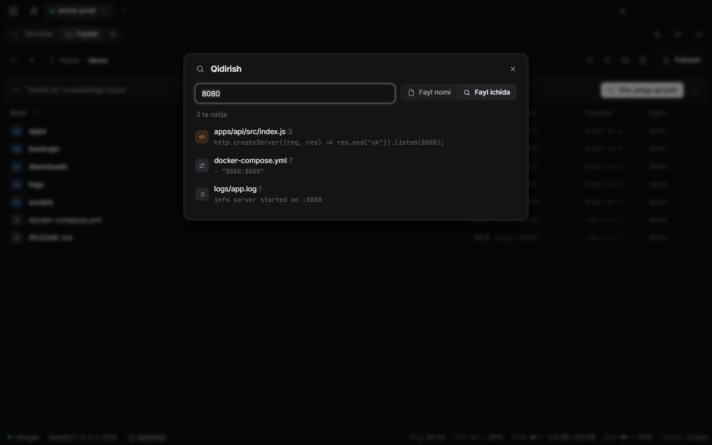

### Muharrir

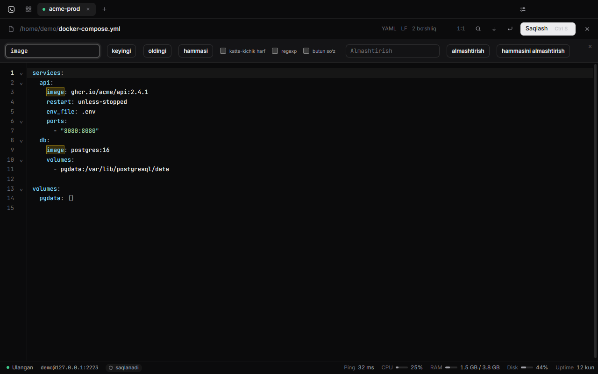

- Kod ranglari: shell, Python, JS/TS, JSON, YAML, Docker, nginx, SQL, PHP, Go, Rust, Markdown, `.env`, `.ini`/`.toml` va boshqalar.
- Qidirish va almashtirish (katta-kichik harf, regexp, butun so‘z), qatorga o‘tish, bekor qilish/qaytarish,
  qatorlarni o‘rash, qator raqamlari, qavslarni yoritish, kod bloklarini yig‘ish.
- `CRLF`/`LF` saqlanadi: Windows’da yozilgan faylning qator oxirlari buzilmaydi.

## Klaviatura

| Tugma | Vazifa |
| --- | --- |
| `Ctrl+Shift+T` / `Ctrl+Shift+W` | yangi terminal / terminalni yopish |
| `Ctrl+Shift+1` `2` `3` | Terminal / Fayllar / Yonma-yon |
| `Ctrl+Tab` | serverlar orasida o‘tish |
| `Ctrl+PageUp/PageDown` | terminallar orasida o‘tish |
| `Ctrl+Shift+A` | AI agent: Claude Code / agy ni yangi terminalda ochish, limitlar |
| `Shift+Enter` | Claude Code / agy’da yangi qator (yubormasdan) |
| `Ctrl+C` / `Ctrl+V` | belgilangan bo‘lsa nusxalash / qo‘yish (`Ctrl+Shift+C/V` ham ishlaydi) |
| O‘ng tugma | belgilangan bo‘lsa nusxalash, aks holda qo‘yish |
| `Shift` + sichqoncha bilan belgilash | sichqonchani o‘zi ushlaydigan dasturlarda (Claude CLI, vim, mc, htop) ham matnni belgilash |
| `Ctrl+Shift+F` | terminalda qidirish |
| `Ctrl` + g‘ildirak | shrift o‘lchami |
| `Ctrl+,` | sozlamalar |

**Fayllarda:**

| Tugma | Vazifa |
| --- | --- |
| `Enter`, `Backspace`, `F2`, `Del`, `F5`, `Ctrl+L` | ochish, yuqoriga, nomini o‘zgartirish, o‘chirish, yangilash, yo‘lni yozish |
| `Ctrl+A` | hammasini belgilash |
| `Ctrl+C` / `Ctrl+X` / `Ctrl+V` | nusxalash / kesib olish / qo‘yish |
| `Ctrl+D` | dublikat |
| `Ctrl+Shift+F` | papka ichidan qidirish |
| `Alt+Enter` | xususiyatlar |

**Muharrirda:**

| Tugma | Vazifa |
| --- | --- |
| `Ctrl+S` | saqlash |
| `Ctrl+F` / `Ctrl+H` | qidirish / almashtirish |
| `Ctrl+G` | qatorga o‘tish |
| `Ctrl+Z` / `Ctrl+Y` | bekor qilish / qaytarish |
| `Alt+Z` | qatorlarni o‘rash |
| `Esc` | yopish |

## Telefon versiyasi (Android)

<p>
  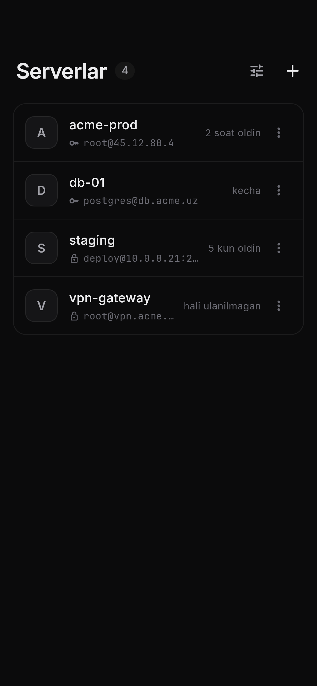
  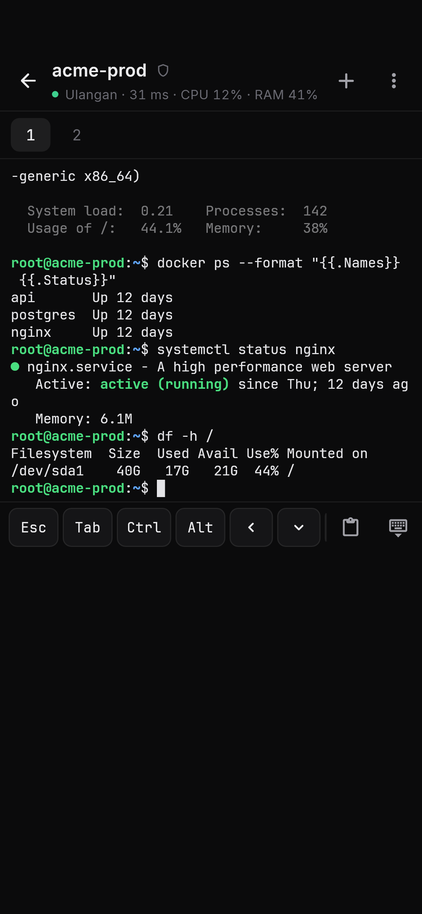
  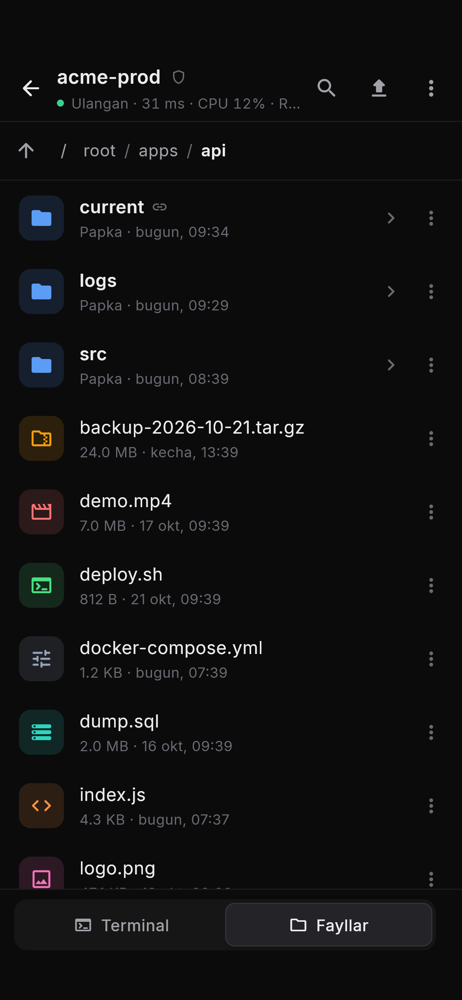
  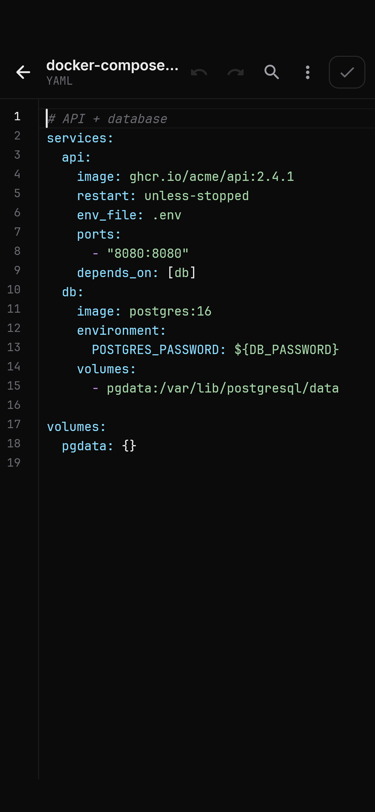
</p>

**O‘rnatish:** APK faylni telefonga o‘tkazing (Telegram “Saqlangan xabarlar”, kabel yoki Google Drive orqali) va oching.
Telefon “Noma’lum manbalardan o‘rnatish”ga ruxsat so‘raydi — shu ilova (Telegram, Fayllar…) uchun ruxsat bering.
Play Protect ogohlantirsa: **Baribir o‘rnatish**.

**Kompyuterdagi Pult bilan bir xil:**
- Bir xil dizayn, terminal + fayllar, ping/CPU/RAM.
- **Sessiyalar umumiy.** Kompyuterda ochilgan `pult-0001` terminalini telefonda o‘sha holatida ko‘rasiz va aksincha (tmux).
- Telefon ilovani fonga yuborsa yoki Wi-Fi ↔ mobil internet almashsa, ilova qaytganingizda darhol qayta ulanadi
  va terminal qolgan joyidan davom etadi. Fayl uzatish ham qolgan joyidan davom etadi.
- Serverdagi dasturlar (Claude CLI, tmux, vim) nusxalagan matn telefon buferiga tushadi.
- Fayllarda: nusxalash/kesib olish/qo‘yish, dublikat, arxivlash va arxivni ochish, qidiruv, xususiyatlar.
- Muharrir: kod ranglari, qator raqamlari, qidirish va almashtirish, qatorga o‘tish, bekor qilish/qaytarish.
- **AI agentlar:** yuqori panel ostida Claude Code va agy limitlari (5 soatlik va haftalik); ✨ tugmasi —
  Claude Code yoki agy ni yangi terminalda ochish (**oxirgi suhbat** ham), limitlar tafsiloti va Claude limitlarini ulash/uzish.
  Terminal yorlig‘ida agent belgisi, boshqa terminalda signal bo‘lsa — nuqta. Agent ishlayotganda qo‘shimcha
  tugmalarda `↵` (yangi qator, yubormasdan) va `📎` (rasm yoki faylni serverga yuborib, yo‘lini yozish).

**Telefonga xos:**
- Klaviatura ustida qo‘shimcha tugmalar: `Esc` `Tab` `Ctrl` `Alt` `← ↓ ↑ →` `- / | ~` `Home` `End` `PgUp` `PgDn`, qo‘yish.
  `Ctrl` va `Alt` keyingi bitta tugmaga qo‘llanadi (masalan `Ctrl` → `c` = to‘xtatish).
- Klaviaturadagi “Yuborish” (Enter) tugmasi buyruqni yuboradi.
- Matnni belgilash: barmoqni bosib turing va suring → **Nusxalash** tugmasi chiqadi.
- **Bir nechta faylni belgilash:** faylni bosib turing, so‘ng boshqalarini bosing — pastda amallar paneli chiqadi.
- **SSH kalitni telefonning o‘zida yaratish:** server formasida “SSH kalit” → “Yangi kalit yaratish” →
  “Ochiq kalitni nusxalash”, so‘ng uni kompyuterdagi Pult orqali serverdagi `~/.ssh/authorized_keys` fayliga qo‘shing.
  (Serverda parol bilan kirish o‘chirilgan bo‘lsa, telefon uchun shu yo‘l kerak.)
- Parollar va kalitlar Android Keystore’da shifrlab saqlanadi.
- Yuklab olingan fayllar: `Download/Pult` papkasi.

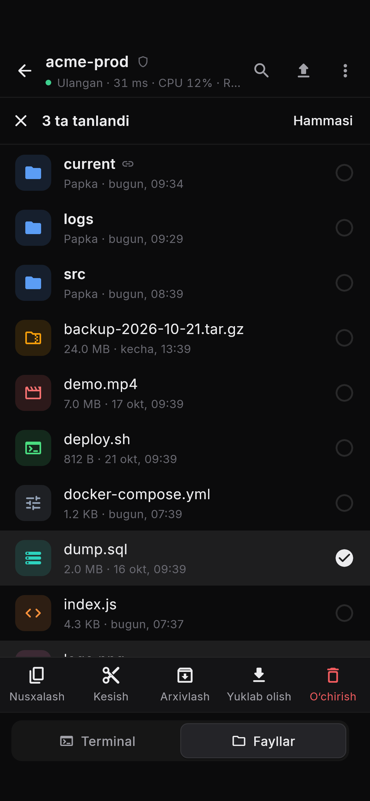

## Server talablari

- SSH (OpenSSH yoki istalgan SFTP qo‘llaydigan server).
- `tmux` — sessiyalar saqlanishi uchun (bo‘lmasa ham ishlaydi, faqat uzilganda sessiya saqlanmaydi).
- Nusxalash, arxiv va qidiruv uchun oddiy Linux buyruqlari: `cp`, `mv`, `tar`, `find`, `grep`, `du`, `stat`.
  `.zip` uchun `zip`/`unzip` yoki `python3` kerak — topilmasa, ilova buni aniq aytadi.
- AI agentlar uchun qo‘shimcha hech narsa kerak emas: Pult o‘z fayllarini faqat serverdagi `~/.pult` papkasida saqlaydi
  (status line skripti, limit ma’lumoti, yuklangan rasmlar).

## Ishlab chiqish

```bash
npm install
npm start          # ilovani ishga tushirish
npm run mock       # sinov uchun lokal SSH server (127.0.0.1:2222, demo/demo; ichida soxta `claude` va `agy` bor)
npm run dist       # release uchun .exe yig‘ish
MOCK_ROOT=<mock papka> node dev/agents-test.js   # AI agentlar: aniqlash, status line, limitlar (mock server kerak)
```

Muharrir (CodeMirror 6) bitta faylga yig‘ilgan: `src/renderer/vendor/codemirror.js`. Uni yangilash uchun:

```bash
cd dev/editor-bundle
npm install
npm run build
```

Telefon versiyasi (`mobile/`, Flutter):

```bash
flutter test test/core_test.dart --dart-define=MOCK_ROOT=<mock papka>   # SSH yadrosi testlari (mock server kerak)
flutter test test/agents_test.dart                                       # AI agentlar: limitlarni o‘qish, skript desktop bilan bir xil
flutter test test/screens_test.dart --update-goldens                    # ekran rasmlari: test/shots
flutter build apk --release --target-platform android-arm,android-arm64
```

APK’ni imzolash uchun `mobile/android/key.properties` va kalit fayli kerak (ular repoda yo‘q).
Ularsiz `flutter build apk --debug` bilan sinov versiyasini yig‘ish mumkin.

### Release

`.github/workflows/release.yml` EXE’larni Windows’da, APK’ni Linux’da GitHub’ning o‘zida yig‘adi
va `package.json` dagi versiya bo‘yicha release chiqaradi (masalan, `v1.1.0`):

1. Versiyani oshiring: `package.json` va `package-lock.json`, `mobile/pubspec.yaml` (`1.1.0+2`: `+` dan keyingi raqam har safar bittaga oshadi),
   telefon sozlamalaridagi yozuv (`mobile/lib/ui/settings_sheet.dart`) va yuqoridagi fayl nomi.
2. `main` ga merge qiling va **Actions → Release → Run workflow** ni bosing (yoki `v1.1.0` tag’ini push qiling).
   Shu versiya uchun qayta ishga tushirilsa, release’dagi fayllar yangilanadi.

Har bir pull request’da ham EXE va APK yig‘iladi (release chiqmaydi), tayyor EXE’lar run sahifasida **Artifacts** ostida 7 kun turadi.

APK release’ga faqat 1.0.0 dagi kalit bilan imzolangan bo‘lsa qo‘shiladi, aks holda telefonlar uni yangilanish sifatida o‘rnatmaydi.
Buning uchun **Settings → Secrets and variables → Actions** da `key.properties` dagi qiymatlar bilan to‘rtta secret kerak:
`ANDROID_KEYSTORE_BASE64` (`.jks` faylining o‘zi, base64 ko‘rinishida), `ANDROID_KEYSTORE_PASSWORD`, `ANDROID_KEY_ALIAS`, `ANDROID_KEY_PASSWORD`.
`.jks` faylini Windows’da base64 qilib nusxalash:

```powershell
[Convert]::ToBase64String([IO.File]::ReadAllBytes("<.jks fayl yo‘li>")) | Set-Clipboard
```

Tuzilishi: `src/main` — SSH ulanish, qayta ulanish, SFTP uzatish, serverdagi fayl amallari (Node.js);
`src/renderer` — interfeys; `dev/` — sinov serveri, testlar va avtomatik skrinshot vositalari;
`mobile/lib/core` — telefon uchun xuddi shu mantiq (Dart), `mobile/lib/ui` — telefon interfeysi.

## Litsenziya

[MIT](LICENSE) © 2026 Sherali Istamov
