# Pult

Serveringizni Windows’dan boshqarish uchun ilova: **SSH terminal, fayllar va serverning o‘zi** (xizmatlar, Docker,
loglar, disk) bitta oynada. Internet uzilsa ham terminaldagi ish to‘xtamaydi. **Claude Code** va **agy** bilan ishlash
uchun alohida qulayliklar bor.

Bepul va ochiq kodli (MIT).

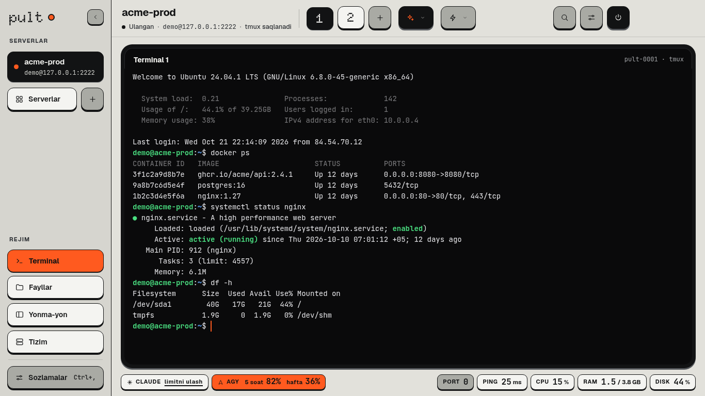

## O‘rnatish

[Releases](https://github.com/sheraliyz/Pult/releases/latest) sahifasidan yuklab oling:

- **`Pult.Setup.<versiya>.exe`** — o‘rnatuvchi (tavsiya etiladi). Start menyu va ish stolida yorliq paydo bo‘ladi.
  Keyingi versiyalar chiqqanda Pult o‘zi aytadi va bir bosishda yangilanadi.
- **`Pult-portable.exe`** — o‘rnatmasdan ishlaydi (o‘zini yangilay olmaydi, faqat yangi versiya sahifasini ochadi).

Windows 10 yoki 11 (64-bit) kerak. Ilova raqamli imzolanmagan, shuning uchun Windows birinchi marta
“Windows protected your PC” deb ko‘rsatishi mumkin: **More info → Run anyway**.

**Serverda:** SSH bo‘lsa yetarli. `tmux` o‘rnatib qo‘ying (`sudo apt install tmux`): shunda aloqa uzilganda ham
terminaldagi dasturlar ishlashda davom etadi.

## Terminal

- **Ish yo‘qolmaydi.** Har bir terminal serverda alohida `tmux` sessiyasida ishlaydi (sizning tmux sozlamalaringizga
  tegmaydi). Internet uzilsa, kompyuter uxlab qolsa yoki Pult yopilsa ham dasturlar ishlashda davom etadi. Qayta
  ulanganda terminal aynan qolgan joyidan ochiladi, oldingi chiqish ham (20 000 qatorgacha) tarixda turadi.
- **O‘zi qayta ulanadi.** O‘lik aloqani ~20 soniyada sezadi va 1, 2, 3, 5… soniya oraliqda qayta ulanadi.
  Uyqudan uyg‘onganda yoki internet qaytganda darhol tekshiradi. Pult ochilganda oxirgi ochiq serverlarga o‘zi ulanadi.
- Bir serverda bir nechta terminal, bir vaqtda bir nechta server. Ichida dastur (Claude Code, vim, build…) ishlayotgan
  terminalni yopishdan oldin so‘raydi.
- To‘liq terminal: ranglar, vim, htop, mc, sichqoncha, Unicode, qidiruv (`Ctrl+Shift+F`). Serverdagi dastur nusxalagan
  matn Windows buferiga tushadi (OSC 52).
- **Tez buyruqlar.** `df -h`, `docker ps` kabi buyruqlarni saqlab, bir bosishda yoki `Alt+1…9` bilan yuborasiz.

## Fayllar

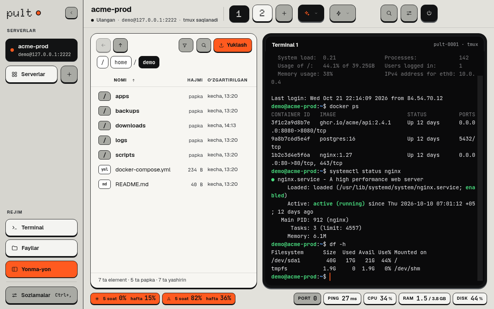

- Ko‘rish, yuklash (sudrab tashlash ham), yuklab olish, nomini o‘zgartirish, o‘chirish, huquqlar (chmod), yangi papka/fayl.
  Har bir fayl turi kengaytmasi bilan ko‘rinadi.
- **Server ichida nusxalash, kesib olish va qo‘yish** (yuklab olmasdan). Bir xil nom bo‘lsa `nom (1)` qilib qo‘yadi,
  ustidan yozmaydi. Dublikat, arxivlash (`.zip`, `.tar.gz`) va arxivni ochish.
- **Qidiruv:** fayl nomi yoki fayl ichidagi matn bo‘yicha. Natija muharrirda aynan o‘sha qatorda ochiladi.
- **Rasmlar** ilova ichida ko‘rinadi (← → bilan keyingisiga o‘tasiz).
- **Kompyuterda ochish:** fayl o‘z dasturida (VS Code, Photoshop…) ochiladi, saqlaganingizda serverga o‘zi qaytadi.
  Serverdagi nusxa bu orada o‘zgargan bo‘lsa, ustidan yozishdan oldin so‘raydi.
- **Uzatish.** Aloqa uzilsa, qolgan joyidan davom etadi. Uzatish paytida ping ko‘tarilmaydi: Pult navbat yig‘ilayotganini
  sezib sekinlashadi, terminal kechikmaydi. Eng tez uzatish kerak bo‘lsa: Sozlamalar → Fayllar → **Maksimal tezlik**.

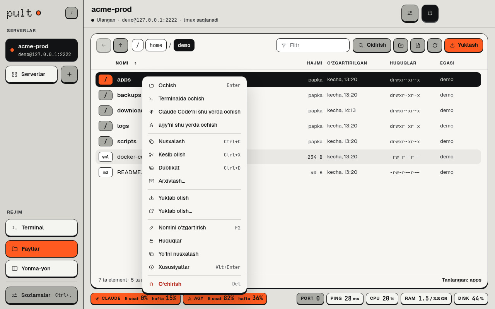

### Muharrir

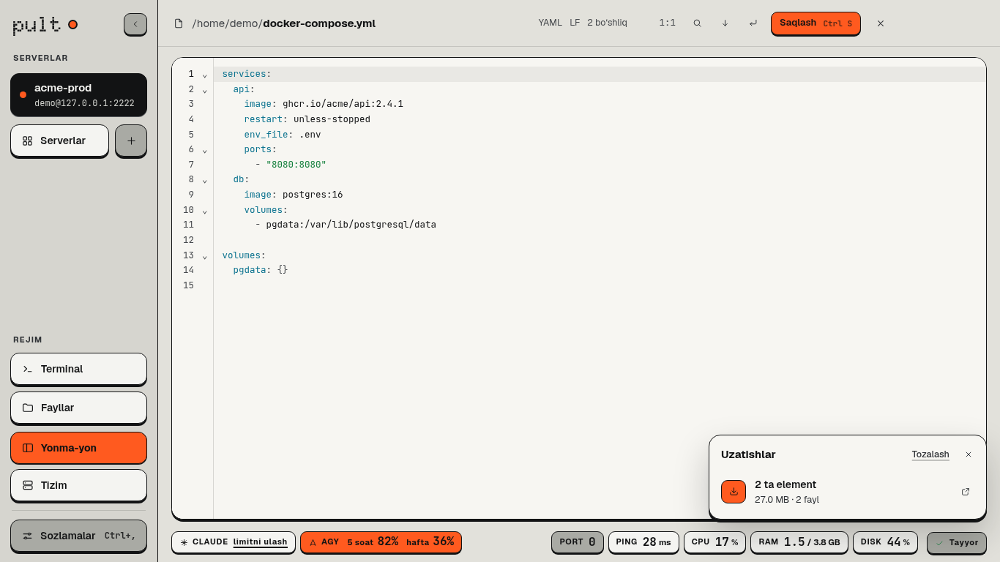

Kod ranglari (shell, Python, JS/TS, JSON, YAML, Docker, nginx, SQL, PHP, Go, Rust, Markdown, `.env` va boshqalar),
qidirish va almashtirish, qatorga o‘tish, qatorlarni o‘rash. `CRLF`/`LF` saqlanadi.

## Tizim: xizmatlar, Docker, loglar, disk

Chap paneldagi **Tizim** (`Ctrl+Shift+4`): serverni terminalsiz boshqarish.

- **Xizmatlar (systemd).** Hamma xizmatlar holati bilan, xatodagilari tepada. Bir bosishda ishga tushirish,
  to‘xtatish, qayta ishga tushirish va loglari. SSH xizmatini to‘xtatishdan oldin alohida ogohlantiradi.

  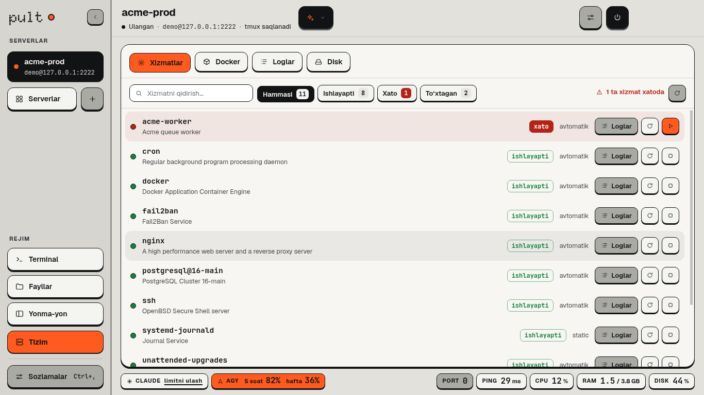

- **Docker.** Konteynerlar holati, portlari, CPU va RAM sarfi; ishga tushirish, to‘xtatish, qayta ishga tushirish, loglar.

  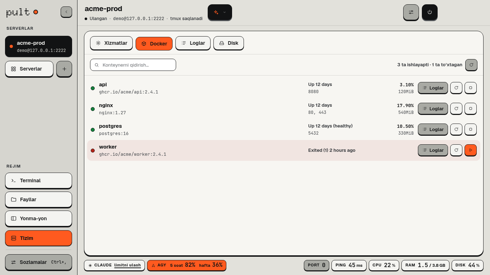

- **Loglar.** Xizmat, konteyner, tizim jurnali yoki istalgan log fayli jonli oqimda. Filtr, pauza, qatorlarni o‘rash.
  Xatolar qizil, ogohlantirishlar sariq rangda. Faylning logini **Fayllar**da o‘ng tugma → **Logni kuzatish** bilan ham ochasiz.

  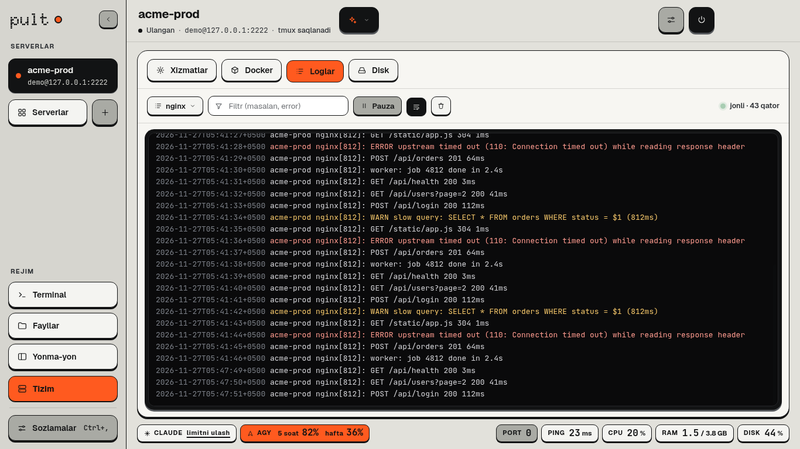

- **Disk.** Disklar qanchalik to‘lgani va **joy nimaga ketgani**: papkalar kattasidan kichigiga, ichiga kirib borasiz.
  100 MB dan katta fayllarni topadi va Fayllarda ko‘rsatadi.

  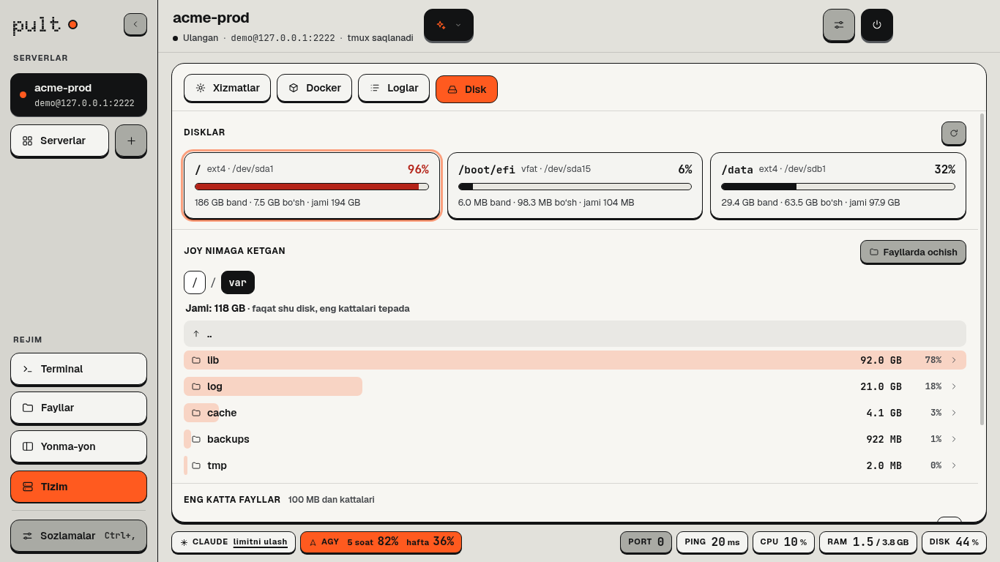

- **Ogohlantirish.** Disk 90% dan oshsa yoki RAM bir daqiqa davomida deyarli to‘lsa, Windows bildirishnomasi chiqadi.
  Bosganingizda kerakli oyna ochiladi.

Root bo‘lmagan foydalanuvchida bu amallar parolsiz `sudo` orqali bajariladi (agar u sozlangan bo‘lsa).

## Server holati va portlar

Pastki qatorda ping, CPU, RAM va disk doim ko‘rinib turadi. Bosganingizda oxirgi 30 daqiqa grafiklari va eng ko‘p
resurs olayotgan jarayonlar chiqadi (keragini to‘xtatish mumkin).

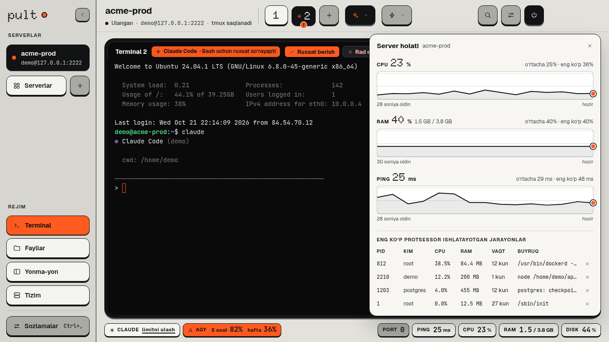

**Portlar (SSH tunnel).** Serverda faqat ichkarida ishlayotgan veb-panel yoki API kompyuteringiz brauzerida
`http://127.0.0.1:<port>` da ochiladi. Pult serverda qaysi portlar ochiqligini ko‘rsatadi, ochilganlarni eslab qoladi.

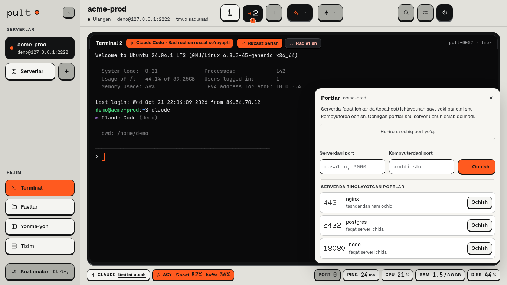

## AI agentlar: Claude Code va agy

Serverda [Claude Code](https://code.claude.com) (`claude`) yoki Antigravity CLI (`agy`) o‘rnatilgan bo‘lsa, Pult ularni o‘zi topadi.

- **Ruxsatga shu yerdan javob berasiz.** Claude buyruq bajarish uchun ruxsat so‘rasa, terminal tepasida
  **Ruxsat berish** va **Rad etish** tugmalari chiqadi. Claude boshqa terminalda so‘rasa, so‘nggi qatorlari bilan kartochka
  chiqadi: o‘sha terminalga o‘tmasdan javob berish mumkin.

  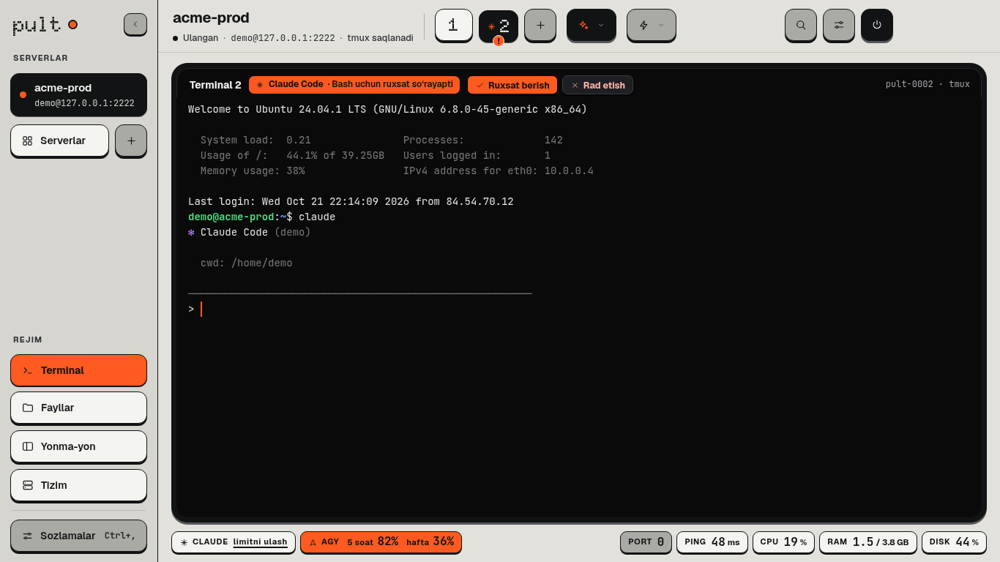

- **Har bir terminalda Claude holati:** ishlayapti, ruxsat so‘rayapti (**!**) yoki tugadi (**✓**). Boshqa oynada
  bo‘lsangiz, Windows bildirishnomasi aniq yozadi: masalan, “Bash uchun ruxsat so‘rayapti”.
- **Limitlar doim ko‘rinib turadi.** Pastki qatorda obunangizning 5 soatlik va haftalik limiti; bosganda batafsil:
  qachon tiklanishi, joriy terminaldagi model va kontekst.
- Birinchi marta pastki qatordagi **Claude → limitni ulash** ni bosing. Pult serverdagi `~/.claude/settings.json` ga kichik
  status line skripti va hooklarni qo‘shadi (o‘zingizning status line’ingiz ishlashda davom etadi, eski fayl
  `settings.json.pult-backup` bo‘lib saqlanadi). **Uzish** hammasini avvalgi holatiga qaytaradi.
- agy limitlari `agy -p /usage` orqali o‘zi olinadi.
- **Bir bosishda ishga tushirish** (`Ctrl+Shift+A`): Claude Code yoki agy yangi terminalda, joriy papkada; oxirgi suhbatni
  davom ettirish ham bor. Fayllarda papka ustida o‘ng tugma → **Claude Code’ni shu yerda ochish**.
- **Skrinshot va fayllar:** rasmni `Ctrl+V` bilan qo‘ysangiz yoki faylni terminalga sudrab tashlasangiz, u serverdagi
  `~/.pult/uploads` ga yuklanadi va yo‘li yoziladi. `Shift+Enter` — yubormasdan yangi qator.

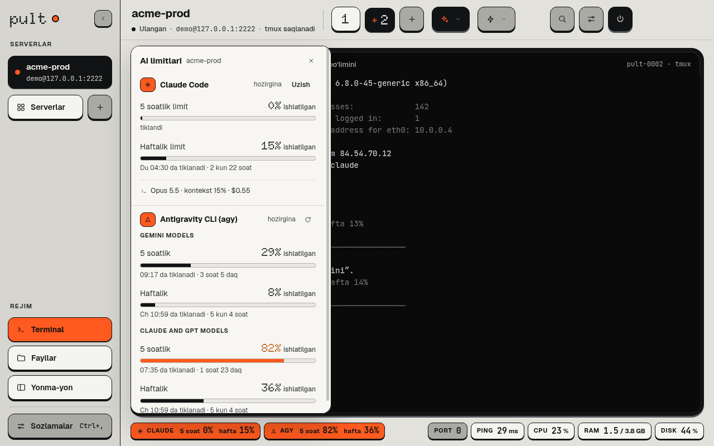

## Ko‘rinish

Och korpus, vazifasiga qarab rangli tugmalar: **to‘q sariq** — asosiy amal yoki tanlangan rejim, **qora** — hozir
qayerdasiz, **kulrang** — yordamchi tugmalar. Terminal har doim qora ekranda. Yorug‘ va qorong‘i mavzu; signal rangi
(to‘q sariq, sariq, ko‘k, yashil) va korpus rangini Sozlamalarda tanlaysiz.

## Xavfsizlik

- Parollar va kalit parollari Windows himoyasi (DPAPI) bilan shifrlab saqlanadi.
- Server kaliti birinchi ulanishda tasdiqlanadi. Keyin o‘zgarsa, Pult ulanmasdan oldin ogohlantiradi.
  `~/.ssh/known_hosts` dagi kalitlar ham tan olinadi.
- Kirish: parol, SSH kalit yoki ssh-agent. `~/.ssh/config` dan import qilish mumkin.
- Pult serverda o‘z fayllarini faqat `~/.pult` papkasida saqlaydi. `~/.claude/settings.json` ni faqat siz
  **limitni ulash** ni bosganda o‘zgartiradi.

## Klaviatura

| Tugma | Vazifa |
| --- | --- |
| `Ctrl+Shift+T` / `Ctrl+Shift+W` | yangi terminal / terminalni yopish |
| `Ctrl+Shift+1` `2` `3` `4` | Terminal / Fayllar / Yonma-yon / Tizim |
| `Ctrl+Tab` | serverlar orasida o‘tish |
| `Ctrl+PageUp` / `Ctrl+PageDown` | terminallar orasida o‘tish |
| `Alt+1…9` | tez buyruqlar |
| `Ctrl+Shift+A` | Claude Code / agy ni ishga tushirish, limitlar |
| `Shift+Enter` | Claude Code / agy’da yangi qator (yubormasdan) |
| `Ctrl+C` / `Ctrl+V` | belgilangan bo‘lsa nusxalash / qo‘yish (`Ctrl+Shift+C/V` ham ishlaydi) |
| O‘ng tugma | belgilangan bo‘lsa nusxalash, aks holda qo‘yish |
| `Shift` + sichqoncha | sichqonchani o‘zi ushlaydigan dasturlarda (Claude Code, vim, mc) ham matnni belgilash |
| `Ctrl+Shift+F` | terminalda qidirish |
| `Ctrl` + g‘ildirak | shrift o‘lchami |
| `Ctrl+,` | sozlamalar |

**Fayllarda:** `Enter` ochish, `Backspace` yuqoriga, `F2` nomini o‘zgartirish, `Del` o‘chirish, `F5` yangilash,
`Ctrl+L` yo‘lni yozish, `Ctrl+A` hammasi, `Ctrl+C` / `Ctrl+X` / `Ctrl+V` nusxalash / kesish / qo‘yish, `Ctrl+D` dublikat,
`Ctrl+Shift+F` papka ichidan qidirish, `Alt+Enter` xususiyatlar.

**Muharrirda:** `Ctrl+S` saqlash, `Ctrl+F` / `Ctrl+H` qidirish / almashtirish, `Ctrl+G` qatorga o‘tish,
`Ctrl+Z` / `Ctrl+Y` bekor qilish / qaytarish, `Alt+Z` qatorlarni o‘rash, `Esc` yopish.

## Server talablari

- SSH (OpenSSH yoki SFTP qo‘llaydigan istalgan server).
- `tmux` — sessiyalar saqlanishi uchun. Bo‘lmasa ham ishlaydi, faqat uzilganda sessiya saqlanmaydi.
- Fayl amallari uchun oddiy Linux buyruqlari: `cp`, `mv`, `tar`, `find`, `grep`, `du`, `stat`. `.zip` uchun `zip`/`unzip`
  yoki `python3` kerak: topilmasa, Pult buni aniq aytadi.
- **Tizim** bo‘limi uchun: `systemctl`, `journalctl`, `docker`, `df`, `du` (qaysi biri bo‘lsa, o‘sha qismi ishlaydi).

## Ishlab chiqish

```bash
npm install
npm start          # ilovani ishga tushirish
npm run mock       # sinov uchun lokal SSH server: 127.0.0.1:2222, demo/demo
npm run dist       # o‘rnatuvchi va portable .exe → dist/
```

Sinov serverida soxta `claude`, `agy`, systemd xizmatlari, Docker konteynerlari, disk va loglar bor: Pult’ning hamma
qismini haqiqiy serversiz sinash mumkin. Linux’da `.exe` yig‘ish uchun `wine` va `wine32` kerak.

Boshqa vositalar (`MOCK_ROOT=<papka>` bilan, sinov serveri ishlab turganda):

```bash
node dev/xfer-test.js <papka>    # fayl uzatish: aloqa uzilganda davom etishi va baytma-bayt to‘g‘riligi
node dev/agents-test.js          # AI agentlar: aniqlash, status line, limitlar
node dev/fsops-test.js           # serverdagi fayl amallari
xvfb-run electron dev/shot.js <ssenariy> <papka> --no-sandbox   # avtomatik ekran rasmlari
```

Muharrir (CodeMirror 6) bitta faylga yig‘ilgan: `src/renderer/vendor/codemirror.js`. Uni yangilash uchun:
`cd dev/editor-bundle && npm install && npm run build`.

**Tuzilishi:**
- `src/main` — SSH ulanish va qayta ulanish, SFTP uzatish, serverdagi fayl amallari, Tizim bo‘limi buyruqlari, AI agentlar (Node.js).
- `src/renderer` — interfeys.
- `dev/` — sinov serveri, testlar va skrinshot vositalari.

## Litsenziya

[MIT](LICENSE) © 2026 Sherali Istamov
